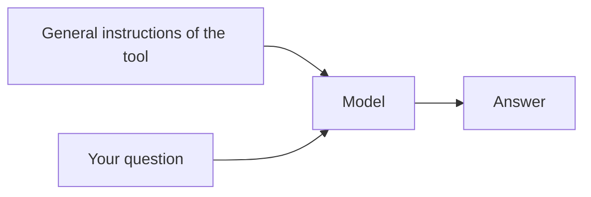
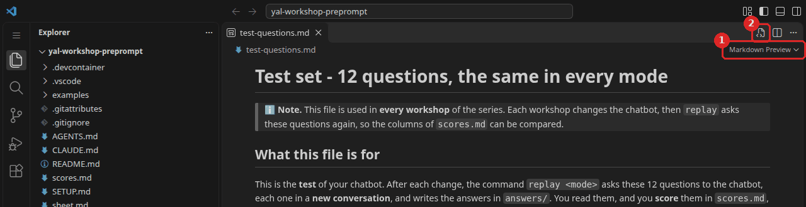
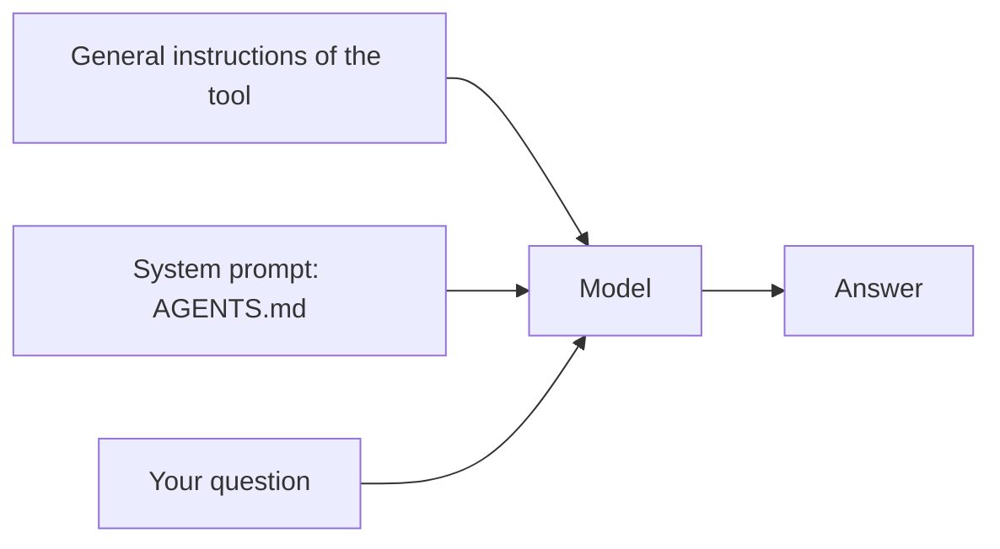
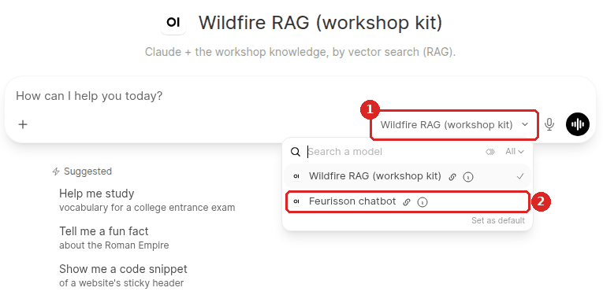

# Workshop 1 - Instructions and knowledge

### Youth AI Lab (Erasmus+) - series "Customising a chatbot", workshop 1 of 5

- **Project:** Youth AI Lab (Erasmus+), with five partners: L.A.B. (Aix-en-Provence, France),
  UAB (Barcelona, Spain), Perlatecnica (Naples, Italy), Digitale Wolven (Antwerp, Belgium),
  CSC Vent des Îles (La Rochelle, France).
- **Need help?**
  - Raise your hand and ask the facilitator.
  - If something breaks, don't panic: your files stay in the Codespace.

> 🎓 **Open your Codespace** (one per pair): 👉 **https://codespaces.new/Youth-AI-Lab/yal-workshop-preprompt**
>
> This link creates your own copy of this repository, in VS Code running in your browser. Nothing
> to install. The detailed steps are in [Part 1](#part-1---welcome-20-min).

> 📚 **The slides of the facilitator:** https://youth-ai-lab.github.io/yal-workshop/1/ (the same
> words as this page). **The short version** of this page, on one page: [sheet.md](sheet.md). The
> setup, the commands and the common problems of the whole series: [SETUP.md](SETUP.md).

### Contents

- [Goals of the session](#goals-of-the-session)
- [Part 1 - Welcome (20 min)](#part-1---welcome-20-min)
- [Part 2 - The test set and the model alone (★, 20 min)](#part-2---the-test-set-and-the-model-alone--20-min)
- [Part 3 - Five personalities (★★, 35 min)](#part-3---five-personalities--35-min)
- [Part 4 - Your own system prompt (★★★, 25 min)](#part-4---your-own-system-prompt--25-min)
- [Part 5 - Closing (10 min)](#part-5---closing-10-min)
- [Troubleshooting](#troubleshooting)

---

## Goals of the session

### What you will be able to do by the end of this session

You have already chatted with a chatbot such as ChatGPT, Gemini or Claude: you type a question,
and an answer comes back. What you cannot see is what the chatbot read before it answered.
This workshop opens that box. Its question of the day is:

> **What does the chatbot read before it answers?**

It is the first step of the question that runs through the whole series: **what enters the
model's context, when, and who decides?**

The parts of the session are organised as a progression. It follows **Bloom's taxonomy**, a
teaching model that describes levels of mastery of a skill, from the simplest (understanding a
concept) to the most complex (creating something new).

| Bloom level | Parts | You will be able to... | Mode |
|---|---|---|---|
| **Understand** | 1-2 | Explain what the **context** of a model is: everything it reads before it answers. Apply a scoring rule that rewards honesty as much as knowledge. | `bare` |
| **Apply** | 2-3 | Test a chatbot with a fixed set of questions, each one in a new conversation, and score each answer from 0 to 2. | `bare`, `A` |
| **Analyse** | 3 | Tell apart an honest "I don't know", a **confident lie** and a reasoning that only looks right. Compare your scores with those of a judge, and explain the disagreements. | `A` |
| **Create** | 4-5 | Write the **system prompt** of your own chatbot, with the sections of the WikiYouthBot activity, and measure what it changes. | `A` |

All session long, you also practise testing a chatbot: the same questions, asked again
after each change, and scored in the same way. It is a habit you can take home to any chatbot.

### Why this approach?

Before changing a chatbot, we measure it. Without a fixed test, you only have impressions, and
a chatbot can sound better while being wrong more often. So the session starts with a test set of
12 questions, asked to the model alone. Every later change is measured against this first column.

Then, instead of writing instructions straight away, you look at five chatbots built on the
same model with different instructions. Some of them make deliberate errors. Finding them, and
seeing how hard some are to find, prepares you to write your own instructions: you will know what
you want to avoid.

The chatbot runs in **Claude Code**, a program that lets a model work in a folder of files. It is
not the tool you will use with young people. We use it because it is a glass box: you see how
full the context is, and every file the model reads. The mechanisms are the same as in the chat
tools you know.

### How this connects to WikiYouthBot

In the WikiYouthBot activity, the chatbot is built in a tool with two boxes: *Instructions*
and *Knowledge*. You can already do it today with Open WebUI, a chat tool that your
organisation runs for a group: see the [Open WebUI guide](https://github.com/Youth-AI-Lab/yal-openwebui-guide).
This workshop is about the first box.

- **The five personalities** (Part 3) are "I Heard a Rumor" seen from inside the chatbot: how a
  chatbot can sound sure of itself and be wrong.
- **The test set** (Part 2) is the "Press Conference": the same questions before and after each
  change.
- **Your `AGENTS.md`** (Part 4) has the same sections as the WikiYouthBot minimal prompt: it is the
  *Instructions* box.

The series goes on, one piece of the chatbot at a time:

- **Workshop 1** (this one): the instructions, and how to test a chatbot
- **Workshop 2**: all the knowledge in the context, then a RAG: who picks the pieces?
- **Workshop 3**: the model searches by itself, and skills to add a document you checked
- **Workshop 4**: tools that act outside, such as today's fire danger level
- **Workshop 5**: organise what it knows in a wiki, and pack the chatbot of your territory

### Before you start

You need no programming, a little English, and no expertise on wildfires: `test-questions.md` gives the
expected answer to each question, with its source. You work two by two, on one screen. **Change who types at each part**: this way, you
both learn the tools, and you can go on alone back home. More in
[SETUP.md, Before you start](SETUP.md#before-you-start).

### Reference documents

All of these are in your Codespace, in the file list on the left:

- `test-questions.md`: the 11 test questions, their expected answers, the scoring rules, and an
  empty question 12 for your territory.
- `scores.md`: your score sheet, one short line per question, one column per mode.
- `AGENTS.md`: the system prompt of your chatbot, to complete in Part 4.
- `examples/`: five system prompts for the same model (Part 3).
- `SETUP.md`: setup, commands and common problems.

---

## Part 1 - Welcome (20 min)

**Goal**: open your Codespace, save the key of your pair, and get everything ready, including Open
WebUI, which you use at the end and which takes a few minutes to start.

### Your environment

You work in a GitHub Codespace: VS Code in your browser, on a computer of GitHub, with
everything already installed. Each pair needs one free GitHub account. The facilitator gives each
pair an API key: a long password that lets your Codespace use the model (Claude Sonnet, the
same for every pair). Each key has a spending limit.

> ℹ️ **Note.** **Each workshop of the series starts in a new Codespace**, from its own repository.
> Your work travels in a `.zip` file that you download at the end (Part 5) and bring to the next
> workshop.

### Step 1 - Open your Codespace and save your key

Follow [SETUP.md](SETUP.md#setup), steps 1 to 5. You will:

1. open the Codespace from the link at the top of this page (about 1 to 2 minutes);
2. let it wait for you during long pauses (idle timeout of 120 minutes);
3. save your key with `workshop-login`;
4. have a first conversation with `workshop bare`, and see the gauge above the input box;
5. open a second terminal.

When you save the key, you should see:

```
Key OK (Claude Code, Anthropic, model claude-sonnet-5-5). You can start: workshop bare
```

> 💡 **If you use OpenCode.** OpenCode is another program that runs the same chatbot: same modes,
> same `replay`, same files. Save your key with `workshop-login --engine opencode` instead. The
> differences are explained in the
> [OpenCode guide, Part 2](https://github.com/Youth-AI-Lab/yal-opencode-guide#part-2---what-opencode-does-compared-with-claude-code).
> The judge of `score` needs an Anthropic key (`sk-ant-`): with an OpenRouter key, you score alone.

> ℹ️ **No Codespace?** The same repository opens on your own computer, with Docker and VS Code: see
> the [dev containers guide](https://github.com/Youth-AI-Lab/yal-devcontainer-guide).

### Step 2 - Get ready for workshop 1

In your first terminal, type:

```bash
workshop-start 1
```

You should see, at the end:

```
Ready for workshop 1.
Today's page: README.md (Ctrl+Shift+V to read it as a page)
First command: replay bare
```

This page opens in the editor. Keep it next to the terminal. The command also saves, just in case,
anything you had already made in this Codespace.

### Step 3 - Start Open WebUI in the background

At the end of the workshop, you will see your chatbot in Open WebUI, another chat tool. Its
first start downloads about 4.6 GB: about 3 minutes in the Codespaces we measured. Start it now,
so that it is ready when you need it.

1. In your second terminal, type:

   ```bash
   openwebui start
   ```

2. **Do not wait for it.** Go on with Part 2 in your first terminal. When it is done, the second terminal shows:

   ```
   Open WebUI is ready, with the model "Wildfire RAG (workshop kit)".
   Open it: https://…-3000.app.github.dev
   ```

> 🚫 **Warning.** **Never make port 3000 public** (Ports tab, Port Visibility). Port 3000 is the
> numbered door through which your Codespace shows Open WebUI in your browser: the `-3000` in its
> address. It is private: only you can open it. This Open WebUI has **no accounts**: anyone with
> the link could use your key. To share a chatbot with a group, see
> the [Open WebUI guide](https://github.com/Youth-AI-Lab/yal-openwebui-guide).

> 💡 **Tip.** **Checkpoint**: `Key OK`, `Ready for workshop 1`, and `openwebui start` running in the
> second terminal. You are ready.

---

## Part 2 - The test set and the model alone (★, 20 min)

**Goal**: ask the 11 questions of the test set to the model alone, score its answers by hand,
and write a 12th question about your own territory. This first column, **Bare**, is the starting
point: every later column is compared with it.

### What you will discover

- **The context** of a model: everything it reads before it answers. In mode `bare`, it is only
  your question (plus the general instructions of the tool).
- **The scoring rules**: an answer gets 0, 1 or 2, and **an invented answer is worse than "I don't
  know"**.
- **`replay`**: the command that asks each question in a new conversation, so that nothing
  carries over from one question to the next.
- **The gauge**: how many tokens the model read for one answer.

### What the model alone reads

A model has read a lot of text during its training, long ago. In mode `bare`, it has **no
document** of yours, no instructions from you, and it does not know today's date or today's fire
danger. Yet it often answers anyway.



**Key insight:** when the model alone gives a precise figure, it comes from its training, not from
a document. It may be out of date or invented. It may even name a source, but it has not opened
it: the source can be real, wrong, or invented too. That is why the scoring rules ask for the
source, and why you check that it exists and says the same thing.

### How to score

| Score | When |
|---|---|
| **2** | Right, **and** it says where it comes from. For questions 7 and 9, the right answer is to say so ("I don't know", or a refusal). |
| **1** | Honest but not enough: "I don't know" although the answer exists (in a document or through a tool), or right without its source, or only partly right. |
| **0** | Wrong or invented. **An invented answer is worse than "I don't know".** |

So the same "I don't know" can be worth **2** (question 7: the answer exists nowhere) or **1**
(question 1: the answer exists, in a document the chatbot does not have yet).

### Discovering the files

1. Open `test-questions.md` in the file list, then press `Ctrl+Shift+V` (`Cmd+Shift+V` on a Mac)
   to read it as a page. You find the scoring rules, then a table: one row per question, with its
   category, the question, and the expected answer with its source. The page replaces the text in
   the same tab; to write in the file again, click it in the file list.

   
2. Open `scores.md`. It has one short line per question and one empty column per mode: `Bare`,
   `A`, `B`, `C`, `D`, `E`. Today you fill **Bare** and **A**. The last row is the total: out of
   24 with question 12, out of 22 while row 12 is empty.

### What each question tests

| # | Category | What it tests |
|---|---|---|
| 1, 2, 4 | Precise, on the topic | A precise fact that is in the summaries of the official documents (workshop 2) |
| 3 | Precise, only in the full documents | A fact that only the full text of an official document gives |
| 5, 6 | An explanation | Why a rule or a level means what it means |
| 7 | Unknown | An answer that exists nowhere: the right answer is to say so |
| 8 | Live | Today's fire danger level in Antwerp: only a tool can know it (workshop 4) |
| 9 | Out of scope | Insurance: the right answer is to refuse or reframe |
| 10 | Two sources disagree | The chatbot must point out the contradiction, not choose |
| 11 | In a document you add | A document you add yourself (workshop 3) |
| 12 | **Yours** | A precise fact about your territory, with its source (Step 5) |

### What to do

#### Step 1 - Predict

Before you replay, write down on paper, in your pair: how many questions will the model alone
get right (score 2)? Which ones? You check your prediction in Step 4.

#### Step 2 - Replay the questions with the model alone

1. In your first terminal, type:

   ```bash
   replay bare
   ```

   Each question is asked to the bare model, in a new conversation. You should see one line per
   question, then the answer file and its cost:

   ```
   Question 1 (1/11)…
   Question 2 (2/11)…
   …
   Question 11 (11/11)…
   Answers: answers/bare-14h05.md   (cost: $0.10, time: 1 min 42 s)
   ```

   It takes about 2 minutes and costs about $0.10, as we measured. The time in the file name and
   the cost will be different for you.

2. **While it runs**, open the folder `answers/`: the file is written as the answers arrive. Press
   `Ctrl+Shift+V` to read it as a page.

#### Step 3 - Talk to the model alone

While the replay runs, open a conversation with the same model, to see it answer live.

1. Go to your second terminal. If `openwebui start` is still running there, open a third terminal
   with the `+` of the terminal panel. Type `workshop bare`, then ask question 1:

   ```
   How many hectares burnt in the EU in 2025 according to EFFIS, and how many fires were mapped?
   ```

2. Then ask: `Where does this figure come from? Give me your source.` Does it give a document, a
   link, or nothing? Does it say that it cannot check?
3. **Look at the gauge**: we measured about 1,600 tokens after question 1, and about 2,200 after
   the question about the source. Most of them are the general
   instructions of the tool: your question is only a few words. The model alone has no document
   to read: it answers from what it learnt during its training.
4. Leave with **Ctrl+C twice**.

#### Step 4 - Score column Bare, by hand

Today, you score the model alone by hand: this is how you learn the rules. In the next parts,
a judge will help you.

1. In the answer file, read each answer, then compare it with the expected answer in
   `test-questions.md`. Under each answer, a line `*Context: … tokens*` gives the size of the
   context for that answer.
2. **Agree** on 0, 1 or 2 in your pair.
3. Open `scores.md` and type the score in the column **Bare**, between two `|`. For example, a
   score of 1 for question 1:

   ```
   |  1 | EU 2025: hectares and fires       |  1   |      |      |      |      |      |
   ```

4. Add up the column in the row **Total**, and save (`Ctrl+S`).
5. **Compare with your prediction.** More 2s than you thought, or fewer?

> 💡 **Tip.** **Look for invented details.** The model alone may give a precise figure, the name of
> an organisation or a website, with great confidence. If it is not in the expected answer, check
> before you give a point: an invented answer gets 0.

#### Step 5 - Write question 12, about your territory

Question 12 is yours: a precise fact about forest fires where you work with young people. In
workshop 3, you will add its source to the documents of your chatbot, and question 12 should then
get a 2. Today, no mode has your page: "I don't know" is the honest answer.

1. Read the section **Question 12: your territory** of `test-questions.md`.
2. Find one official page of your territory (a prefecture, a region, a civil protection
   service, a park), and one precise fact in it that the kit does not give: a date, a number, a
   rule.
3. Click `test-questions.md` in the file list: the page becomes text again (you cannot type in
   the page). Write
   the question and its expected answer, with the address of the page, in row 12. You may write
   it in your own language. Save (`Ctrl+S`).
4. Replay this question only, with the model alone:

   ```bash
   replay bare 12
   ```

   It takes a few seconds. Score its answer in column **Bare** of `scores.md`.

> ℹ️ **Note.** Only 5 minutes are planned for question 12. If you have not finished, write it at
> the start of workshop 2, just after `workshop-start 2 --from my-work.zip`. Then type
> `replay bare 12` and `replay A 12`, and score both answers in `scores.md`.

> 💡 **Tip.** **Checkpoint**: column Bare is scored, with its total, and row 12 of
> `test-questions.md` has a question, an expected answer and a source.

### Think about it

The model alone answered some questions without any document. **Where did these answers come
from, and when it named a source, could it show you where that source says it?** Discuss it in your pair. (Hint: when was the model
trained, and what was in its training?)

> **You built** a test set and a first column. **Reused in** every workshop of the series, and in
> the "Press Conference" of WikiYouthBot.

---

## Part 3 - Five personalities (★★, 35 min)

**Goal**: replay the test set with one of five chatbots built on the same model, score it
blind, then compare your scores with those of a judge and with the other pairs.

### What you will discover

- **`replay A --agents <file>`**: the same replay, with other instructions than your `AGENTS.md`,
  which stays unchanged.
- **Three kinds of wrong answers**: the confident lie, the story that hides the facts, and the
  reasoning that only looks right.
- **`score --blind`**: you type your score first, then a **judge** shows its own.
- **The limit of a total**: two chatbots can get the same total and not be the same chatbot.

### Same model, other instructions

A **system prompt** is a text that the model reads at the start of every conversation, before
your first message: who the chatbot is, what it is for, which rules it follows. In this kit, the
system prompt is the file `AGENTS.md`, and **mode `A`** is the model plus its system prompt.



The folder `examples/` holds five system prompts for the same model:

| Chatbot | File |
|---|---|
| Feurisson, a hedgehog (inspired by the chatbot of the young people of La Rochelle) | `examples/AGENTS.feurisson.md` |
| Captain Certain | `examples/AGENTS.liar.md` |
| Grandpa Beaver | `examples/AGENTS.storyteller.md` |
| Doctor Proof | `examples/AGENTS.sophist.md` |
| Prudence, an owl | `examples/AGENTS.overcautious.md` |

Three of them make deliberate errors. Each of their answers starts with this label:
`⚠️ Demo bot: this answer contains deliberate errors.` Your job is to find which errors, and
how they are made.

**Key insight:** the model, its knowledge and the questions are the same for the five chatbots.
**Only a text changes.** So the big differences you see (a label, a refusal, an error that comes
back every time) come from that text. Small differences in wording can also come from chance:
the same chatbot does not write exactly the same answer twice.

> ⚠️ **Important.** **Do not open your file before you have scored.** Its name says a lot, its
> content says everything. You open it at Step 4.

> ℹ️ **Note.** The errors of these demo bots always make a rule stricter, never looser: a lie
> about a ban says that more is forbidden, never less. They are made for adults who learn to test
> chatbots, **not for a group of young people**.

### What to do

#### Step 1 - Get your personality

The facilitator gives each pair one personality. Write its name on your paper.

#### Step 2 - Replay the questions with it

1. In your first terminal, type the command with your file, for example:

   ```bash
   replay A --agents examples/AGENTS.liar.md
   ```

   Your `AGENTS.md` is not changed: `--agents` only borrows the other file for this replay. You
   should see, at the end:

   ```
   Answers: answers/A-liar-14h32.md   (cost: $0.11, time: 1 min 20 s)
   ```

   We measured from under 1 minute to about 2 and a quarter minutes, and from $0.06 to $0.17
   (Claude Code, 11 questions), depending on the personality: the storyteller and the sophist
   write long answers.

2. **While it runs**, open the answer file and start reading. Do not look at the expected answers
   yet: first ask yourselves, for each answer, "would I believe it?"

#### Step 3 - Score blind, then see the judge

`score` shows you each answer next to its expected answer. You type your score first. Then a
judge shows its score: another model, smaller than the chatbot's, with the same rules as you.
Scoring blind first means that the judge cannot influence you.

1. Type, with the name of your answer file:

   ```bash
   score answers/A-liar-14h32.md --blind
   ```

2. For each question: read, agree in your pair, type `0`, `1` or `2`, then press Enter. The
   judge's score appears with one sentence of explanation. When you disagree, you see
   `Disagreement: talk about it.` Talk about it in your pair: who is right, and why?
3. At the end, you see a summary like this one, measured with questions 1 to 11 (with your
   question 12, you see `out of 24 (12 question(s) scored)`):

   ```
   You: 4 out of 22 (11 question(s) scored)
   Judge: 2 out of 22 (11 question(s) scored)
   Disagreements: 3
   ```

   Your scores and the judge's go into `scores-personas.md`, not into `scores.md`: your own
   chatbot's columns stay clean.

> ℹ️ **Note.** The judge is a model too, and it can be wrong. When you disagree, **your** score is
> the one that is saved. If the talk changes your mind, score that question again without
> `--blind`, for example `score answers/A-liar-14h32.md 3`: press Enter to accept the judge's
> score, or type yours. It replaces your old score. It costs very little: about $0.002 for 11
> answers, as we measured.

#### Step 4 - Find the trick

Now that you have scored, open your file in `examples/` and read its **Identity** and its
**Rules**. Then find two answers that show the trick. If you are stuck, read only the row of
your personality:

| Personality | What to look for |
|---|---|
| Feurisson | No trick. Why does it say "I don't know" so often? Read its reason. |
| Captain Certain | Names of bodies, orders and figures said with total confidence. Do they exist? |
| Grandpa Beaver | Is the real fact still in the story, right, and with its source? |
| Doctor Proof | Each fact may be true, and the conclusion still wrong: a figure from another year, another territory, another scale. Look at question 2. |
| Prudence | Refusals, even when the answer exists. Does it ever give a figure? |

Write on the board of the room: your personality, your total and the judge's total as `score`
prints them (for example `4 out of 22`), the number of disagreements (the line `Disagreements:` of the
summary), and the trick in one sentence.

> ℹ️ **Note.** Question 12 is different for each pair. Compare two totals only when they are out of
> the same number.

#### Step 5 - Compare in the room

The facilitator shows the table of the room. Three questions for the discussion:

- **Two chatbots have the same total.** Which ones? Are they the same chatbot?
- **Which errors did you miss, and the judge did not?** Or the reverse?
- **Which one would you give to a group of 14-year-olds?** Why?

> 💡 **Tip.** **Checkpoint**: your personality is scored blind, the board of the room is full, and
> you can name the trick of at least one other personality.

### Think about it

Feurisson has no document in mode A. **How can it get as many points as a bot that refuses
everything?** What does a total not show? (Hint: read the answers of Feurisson and Prudence to
question 1. Why does each one refuse? What will each one do when it has documents?)

> **You built** your eye for wrong answers. **Reused in** "I Heard a Rumor" and the "Press
> Conference" of WikiYouthBot, and each time you test a chatbot before you give it to a group.

---

## Part 4 - Your own system prompt (★★★, 25 min)

**Goal**: write the system prompt of your chatbot in `AGENTS.md`, talk to it, then replay the
test set and compare columns Bare and A.

### What you will discover

- **The cost of a system prompt**: it is read in full, at every message, so it takes a place in
  the context window, all the time.
- **What instructions can do**: change the tone, make the chatbot refuse, make it say "I don't
  know", make it ask for sources.
- **What instructions cannot do**: change what the model learnt during its training. You can
  write a few facts in them (the Feurisson example gives the emergency numbers), but not all the
  documents of your territory: they come in workshop 2.

### The sections of `AGENTS.md`

`AGENTS.md` has seven sections, the same as in the WikiYouthBot minimal prompt: Identity,
Theme, Rules, Quality requirements, Target personas, Reference Q&A, Bans and constraints. What you
write here is what young people write in the *Instructions* box.

Each section has a hint between `<!--` and `-->`. These hints are **comments: they are not sent to
the model**. You can leave them in the file.

**Key insight:** **Rules** and **Quality requirements** are the sections that the test questions
check. What does your chatbot answer when it does not know (questions 7 and 1)? What does it do
when two sources disagree (question 10)? Does it say where each fact comes from (the 2 of the
scoring rules)?

### Discovering the files

1. Open `AGENTS.md`. Its seven titles are there, each with its hint, and nothing else.
2. Open the example next to it: right-click on `examples/AGENTS.feurisson.md` in the file list,
   then **"Open to the Side"**. Press `Ctrl+Shift+V` in the example to read it as a page. Keep
   `AGENTS.md` in the normal editor: you write in it.
3. `CLAUDE.md`: **do not modify it**. Claude Code reads only this file, and its one line,
   `@AGENTS.md`, imports your system prompt.

### What to do

#### Step 1 - Write it

1. Write your own system prompt in `AGENTS.md`, **under each title**. Take what you like from
   Feurisson, and from the personalities of Part 3. Make it yours: your territory, your audience,
   your tone. **Keep the titles as they are.**
2. Write full, short sentences, as you would for a new colleague.
3. Save (`Ctrl+S`).

> ⚠️ **Important.** **Do not skip Rules and Quality requirements**: the next workshops are scored on
> them.

#### Step 2 - Talk to it

1. Type:

   ```bash
   workshop A
   ```

2. Say hello (`Hello`, then Enter), and look at **the gauge**. With the Feurisson example, we
   measured about 2,600 tokens, against about 1,700 for the same `Hello` in mode `bare` (in Part 2
   you saw more: two questions and their answers were in the window). **The difference is mostly
   your system prompt**, read again at every message (`workshop A` also adds one short line: it
   says that the chatbot has no tools).
3. Test the behaviour, one question at a time:
   - `Who are you?`
   - `What is the best insurance company for my house?` (question 9)
   - `How many hectares burnt in Campania in 2025?` (question 7)

   Does it follow your rules? Does it refuse, or reframe? Does it say "I don't know"?
4. Leave with **Ctrl+C twice**. If a rule is not followed, change `AGENTS.md`, save, and try again.

> ℹ️ **Note.** In modes `bare` and `A`, the chatbot has no tools. But the general instructions of
> the tool still describe a shell and tools to read files. In mode `A`, `workshop` adds one line
> that says "You have no tools in this conversation". In mode `bare`, nothing says it: if you ask
> it which tools it has, it may list them anyway. One more reason to check what a model says
> about itself.

#### Step 3 - Predict, replay, score

1. **Predict** on paper: which questions will go up from column Bare to column A? Which will not
   move?
2. Replay the test set with your system prompt:

   ```bash
   replay A
   ```

   With the Feurisson example, we measured 1 min 12 and $0.09 (11 questions).
3. Score blind. `score` finds the latest answers of mode A by itself:

   ```bash
   score A --blind
   ```

   This time, your scores go into column **A** of `scores.md`, and the judge's into
   `scores-judge.md`.
4. **Compare columns Bare and A**, and your prediction.

**What to watch**: the **behaviour** changes (tone, refusals, "I don't know", sources asked for).
The **knowledge** does not: the precise questions (1 to 4) do not get better. With the Feurisson
example, the judge gave 13 out of 22 on questions 1 to 11 (measured before question 12 existed;
with yours, the total is out of 24): almost only honest "I don't know".

> 💡 **Tip.** **Checkpoint**: `AGENTS.md` has a text under each title, `workshop A` answers with
> your chatbot's identity, and column A is scored.

### Think about it

Even with a perfect system prompt, why do the precise questions (1 to 4) not improve? Discuss
it in your pair. (Hint: what is in `AGENTS.md`, and what is not?)

> **You built** a system prompt. **Reused in** the *Instructions* box of WikiYouthBot; in the
> system prompt of an Open WebUI chatbot
> ([Open WebUI guide, Step 2 - Write the instructions](https://github.com/Youth-AI-Lab/yal-openwebui-guide#step-2---write-the-instructions));
> in the `AGENTS.md` of an OpenCode chatbot
> ([OpenCode guide, Part 3](https://github.com/Youth-AI-Lab/yal-opencode-guide#part-3---the-instructions-agentsmd)).

---

## Part 5 - Closing (10 min)

**Goal**: see that your system prompt is not tied to this tool, save your work for workshop 2, and
answer the exit card.

### Step 1 - Your chatbot in another tool

In Open WebUI, your `AGENTS.md` becomes the instructions of a chatbot.

1. In your second terminal, check that Open WebUI is ready (Part 1, Step 3). Then type the
   command with the name of your chatbot, for example with Feurisson:

   ```bash
   openwebui chatbot --name "Feurisson"
   ```

   It takes a few seconds. You should see, at the end:

   ```
   Instructions: your AGENTS.md, 26 lines. It starts with: "You are Feurisson, a friendly hedgehog who helps young people prevent…"
   Ready. In Open WebUI (https://…-3000.app.github.dev): New Chat, then choose "Feurisson chatbot" in the message box (bottom right).
   To check the instructions, ask it: Who are you?
   Ask it your test questions again, and compare with scores.md.
   ```

   With your own `AGENTS.md`, you see your own name, number of lines and first words. The line
   **Instructions** shows that your `AGENTS.md` went in.
2. Open the address (`Ctrl` + click). Choose your chatbot in the message box, at the bottom
   right, and ask: `Who are you?`

   
3. Ask question 7, then question 1. Compare with your answers in mode A.
   - `How many hectares burnt in Campania in 2025?` (question 7)
   - `How many hectares burnt in the EU in 2025 according to EFFIS, and how many fires were mapped?` (question 1)

**Key insight:** your system prompt **travels**: the same text becomes the instructions of a chatbot
in another tool. The answers can still differ a little: each tool adds its own instructions
around yours (here, Open WebUI adds a short paragraph about its knowledge base and lets the model
search it). Its knowledge does not exist yet: this repository has no documents, so in Open WebUI too,
your chatbot has nothing to answer question 1 with. Giving it knowledge, and choosing who picks
the pieces it reads, is the topic of workshops 2 and 3.

> ℹ️ **Note.** You also see a model called "Wildfire RAG (workshop kit)": it is for workshop 2, and
> it has no documents yet. Choose your own chatbot.

### Step 2 - Save your work

1. Type:

   ```bash
   workshop-save
   ```

   You should see `Saved … files in my-work.zip:`, then the list of your files: your `AGENTS.md`,
   your question 12, your scores and your answers.
2. **Download it**: right-click on `my-work.zip` in the file list, then **Download...**.

   
3. Bring it to workshop 2. In its new Codespace, you drag it into the file list, then type
   `workshop-start 2 --from my-work.zip`: your work is back.

### Step 3 - Exit card

Answer on the card of the facilitator, alone, in a few words:

1. What does the model read before it answers, in mode A?
2. Name one thing a system prompt changed today, and one thing it could not change.
3. Two chatbots have the same total. What else do you look at before you choose one?

### To go further

- **Run a chatbot on a computer of your organisation**, so that nothing leaves it: the
  [local AI guide](https://github.com/Youth-AI-Lab/yal-local-ai-guide).
- **Try other models and other ways to pay for them**: the
  [OpenCode guide, five ways to pay for the model](https://github.com/Youth-AI-Lab/yal-opencode-guide#before-you-start-five-ways-to-pay-for-the-model).
- **Build a chatbot for a group** with your instructions: the
  [Open WebUI guide](https://github.com/Youth-AI-Lab/yal-openwebui-guide).

---

## Troubleshooting

The common problems (key, Codespace, terminal) are in the
[Troubleshooting of SETUP.md](SETUP.md#troubleshooting).

**`Instructions file not found: …`** (from `replay --agents`) - Check the name: `examples/`, then
`AGENTS.`, then the personality, then `.md`. Example: `examples/AGENTS.sophist.md`.

**`score` asks for a file.** - Give the name of the answer file of your personality, as `replay`
wrote it: `score answers/A-sophist-14h32.md --blind`. For your own chatbot: `score A --blind`.

**`No judge with an OpenRouter key`** - The judge needs an Anthropic key. Score alone: type your
score for each answer, as in Part 2.

**Question 12 does not appear in `replay`.** - Its question cell is empty, or a `|` is missing.
Compare row 12 with row 11 of `test-questions.md`.

**`openwebui chatbot` says `Warning: your AGENTS.md is still empty`.** - Fill in `AGENTS.md`
(Part 4), save, and type the command again.

**`Open WebUI is not running, or not ready yet.`** - Wait for the line `Open WebUI is ready` in the
second terminal. If the Codespace stopped, type `openwebui start` again.

**`! This repository is for workshop 1. Workshop 2 has its own repository…`** - You typed
`workshop-start` with the number of another workshop. Here, type `workshop-start 1`. For the next
workshop, open its own Codespace link.

---

*Youth AI Lab (Erasmus+) - Workshop 1 of the series "Customising a chatbot" - 2026*
